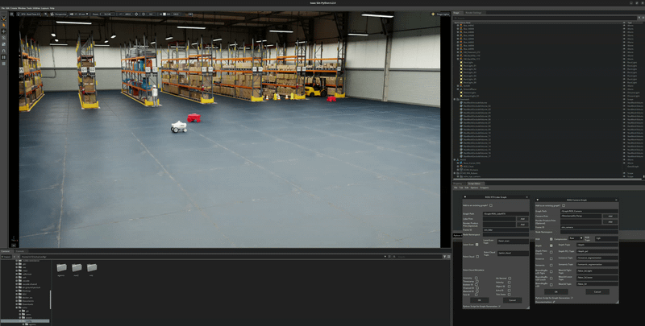
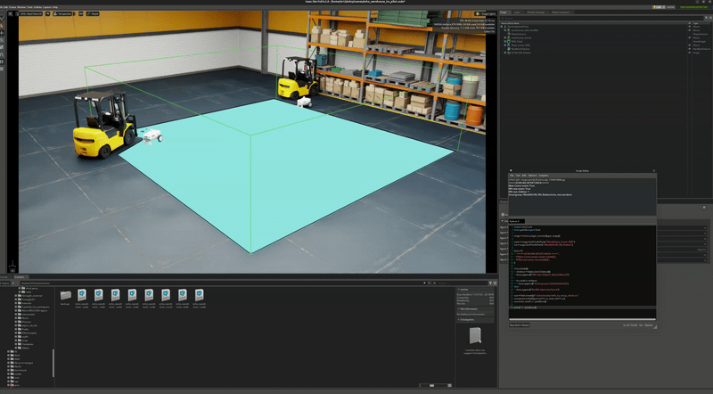
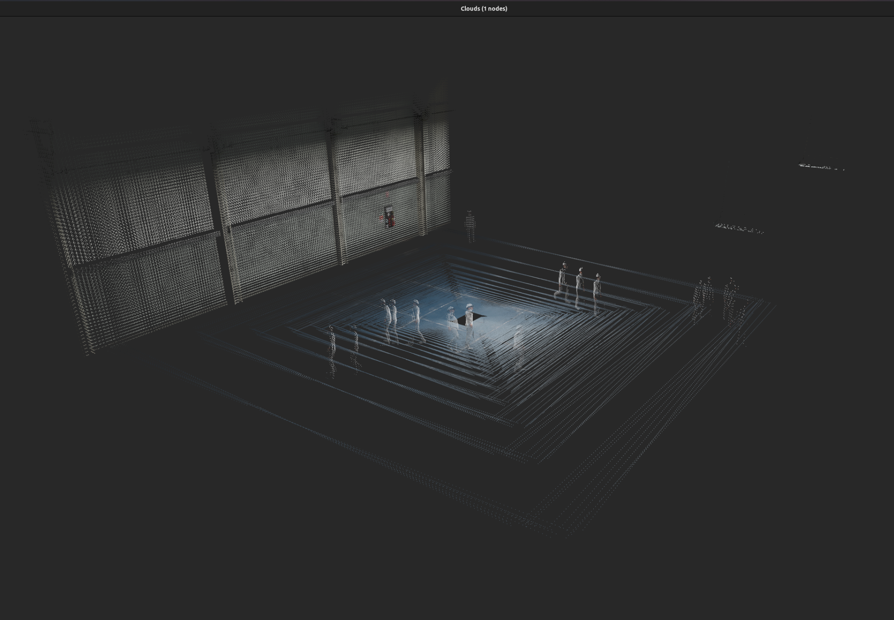

# ECHO

<!-- ECHO_PHASE_D_20261128 -->
## Current research checkpoint — 28 November 2026

Phases A–C are complete at their defined engineering scope. Phase D (S04) experiments are complete at controlled engineering-pilot scope: bounded obstacle/stale-sensor response, static and dynamic acquisition, one/four RGB-D versus 3D LiDAR geometric comparison, corrected RTAB-Map replay and native trajectory evaluation. The next research phase is E / S05 (global relocalization and revisits). Phase G is the candidate original contribution: joint multi-view association, localization uncertainty, visibility evidence and multi-visit persistent object hypotheses. No novelty or physical-sensor accuracy claim is established yet.

- [Phase D technical report](docs/ECHO_PHASE_D_CLOSEOUT_20261128.md)
- [Current project context](docs/ECHO_PROJECT_CONTEXT_20261128.md)
- [Updated roadmap](docs/ECHO_ROADMAP_20261128.md)
- [Phase E handoff](docs/ECHO_PHASE_E_HANDOFF_20261128.md)

The dated checkpoint supersedes older progress statements below; historical descriptions and demos are retained. Verify Git tag and archive status locally.
<!-- /ECHO_PHASE_D_20261128 -->


### **E**nvironmental **C**hange and **H**istory of **O**bjects

**Persistent 3D Object Memory, Multi-View Relocalization and Environmental Change Detection for Mobile Robots**

ECHO is an independent robotics R&D project exploring how a robot can map an environment, recover its location on a later visit, remember individual objects, and distinguish true environmental changes from limited or occluded observations. It uses NVIDIA Isaac Sim 6.2, ROS 2 Jazzy, Nav2, RTAB-Map and a ROS-enabled Nova Carter in a dynamic warehouse.

**Research goals:** (1) measure how one versus four simulated D455-style RGB-D cameras perform in mapping and unknown-start relocalization, retaining the existing 3D LiDAR as a separate reference; (2) build a persistent object-centric memory that recognizes moved, appeared and removed objects while refusing to equate an unseen object with a removed one. Dynamic tracking and possible Nav2 integration are later extensions.

> **Current state — 27 November 2026:** Phase C is complete at its engineering scope. Four simulated D455-style RGB-D cameras feed one synchronized RTAB-Map instance. Coupled XY calibration, concurrent NAV-0 navigation and preliminary 3D mapping have been validated. Next: S04 controlled sensor comparison.

## Demos

### Dynamic warehouse — NPC robots and warehouse workers



Isaac Sim warehouse with the main ROS Nova Carter, mobile NPC Nova Carters and animated workers. The completed M04C scenario verified two independently moving red NPCs, two workers, four distinct actor IDs and 10 Hz simulation ground-truth trajectories.

### Autonomous navigation — ROS 2 Nav2



Previously verified white Nova Carter localization and autonomous navigation in a preserved warehouse reference scene.


### Four-camera RGB-D mapping — Phase C



Three successful navigation goals, 113 stored RGB-D observations,
452 verified camera models and nine retained graph locations.

Repeated human-shaped returns illustrate the dynamic-object ghosting
problem that motivates ECHO. Persistent object tracking and global
relocalization remain research objectives.

## Research and status

| Work package | Status | Evidence / caveat |
|---|---|---|
| M01–M02 — Isaac warehouse and Nav2 | Completed baseline | Preserved navigation scene and launcher |
| M03 — Office RGB-D/object prototypes | Early experiments | Tracked `raafif_office*.usd`, `data/before`, `data/after`, `results/experiment_01`–`05`; not a mobile persistent-memory validation |
| M04C — Dynamic agents | Complete at scope | Two red NPC robots, two animated workers, simulator GT |
| M04D — Worker sensor visibility | Complete at scope | RGB visibility and GT-gated 3D LiDAR evidence; not independent detection/tracking |
| S01-A/B — Front simulated D455 | Validated | RGB, depth, CameraInfo, TF and XYZ cloud |
| S02 — Front D455 / 3D LiDAR | Preliminary baseline | Historical mapping comparison; not a controlled sensor ranking |
| S01-C — Rear, left and right | Completed | Four validated RGB-D pipelines |
| S01-D / S03 — Four-camera RTAB-Map | Completed at scope | One synchronized mapping instance, concurrent NAV-0 and native 3D visualization |
| **S04 / R01 — Controlled sensor comparison** | **Next** | One D455 vs four D455s vs 3D LiDAR |
| R02 — Global relocalization | Planned | Unknown-start and revisit localization |
| M05+ — Revisit events and object memory | Planned | Object change GT → association → occlusion-aware evidence → optional tracking/Nav2 |

The preliminary S02 geometrical correspondence figures are **not** depth-calibration accuracy or relocalization success. See the dedicated report for interpretation limits.

## Technology stack

| Area | Current technology |
|---|---|
| Simulator / compute | NVIDIA Isaac Sim 6.2, Ubuntu 24.04, RTX 5080 |
| Robot & middleware | White ROS-enabled Nova Carter, ROS 2 Jazzy, TF, odometry, Nav2, RViz2 |
| Sensors | Existing 3D LiDAR and four simulated D455-style RGB-D cameras |
| Mapping | Preserved navigation baseline; NAV-0 and four-camera RTAB-Map |
| Perception prototypes | Python, OpenCV, SAM 2.1, PyTorch; early office object-association experiments |
| Reproducibility | Versioned USD scenes/scripts/configuration, simulator GT, ROS recordings and quantitative analysis |

Simulated D455-style rendering does not reproduce or validate the physical D455's active stereo, optical limitations, IR interference, noise, USB bandwidth, timing or hardware extrinsics. The algorithmic RGB-D interfaces should transfer; synthetic camera parameters should not.

## Getting started — preserved navigation demo

```bash
cd ~/echo
bash scripts/start_echo_sim.sh
# In another terminal after simulation startup:
bash scripts/start_echo_nav.sh
```

Use **Nav2 Goal** in RViz for the existing single-robot navigation reference. These are not commands to launch the four-camera experiment.

The front-D455 development stack, which **requires files from the S01 branch**, was previously started with:

```bash
cd ~/echo
bash scripts/start_echo_d455_front_stack.sh
# In Isaac Sim, open scenes/s01_d455/s01_d455_front_ros_depth_raw_verified.usda
# and press Play. Inspect script/scene dependencies before a new run.
```

The S01 report notes that reuse of an already running Isaac Sim instance was tested; full cold-start/shutdown behavior was not established. The 3D LiDAR and original scenes must remain preserved.

## Phase C report and reproduction instructions

[Read the final Phase C technical report](docs/ECHO_PHASE_C_CLOSEOUT_20261127.md).

## Documentation

| Start here | Purpose |
|---|---|
| [`docs/ECHO_MASTER_PLAN.md`](docs/ECHO_MASTER_PLAN.md) | Full research roadmap, milestones, work-package gates, scientific claims and dependency ordering |
| [`docs/ECHO_ARCHITECTURE.md`](docs/ECHO_ARCHITECTURE.md) | Current vs proposed ROS/Isaac interfaces, camera/TF contract and system architecture |
| [`docs/ECHO_EXPERIMENT_PROTOCOL.md`](docs/ECHO_EXPERIMENT_PROTOCOL.md) | Controlled one-D455/four-D455/3D-LiDAR mapping, unknown-start relocalization and object-change evaluations |
| [`docs/echo_phase_b_m04c_m04d.md`](docs/echo_phase_b_m04c_m04d.md) | Completed dynamic-warehouse Phase B measurements and limitations |
| [`docs/echo_s01_front_d455.md`](docs/echo_s01_front_d455.md) | Dated 19 Nov front D455 implementation, exact synthetic intrinsics/optical TF, QoS and throughput |
| [`docs/echo_s02_preliminary_comparison.md`](docs/echo_s02_preliminary_comparison.md) | Reported 19 Nov front RGB-D RTAB-Map and 3D LiDAR comparison, with important methodological caveats |

The S01 front report is a **historical checkpoint**. Its final section says RTAB-Map is pending as of 19 Nov *when that document was written*; the later S02 report records the subsequent preliminary mapping work. Keep these dated milestones separate.

## Scientific and repository conventions

We distinguish **proposals**, **implemented interfaces**, **observed runtime behavior**, and **quantitative validated results**. Simulator GT is for scoring, not an input to the autonomous estimator. A unified map does not prove unknown-start relocalization. An object missing from view is not automatically removed.

Raw bags, databases and large point clouds are local experiment outputs unless an explicit dataset release is prepared. Check and preserve existing uncommitted work before switching branches or staging files. The historical navigation baseline is tagged `echo-nav-v1`.

---

*ECHO is an active research prototype. Reported capabilities and limitations apply to the specific tested milestones, not assumed downstream performance.*
