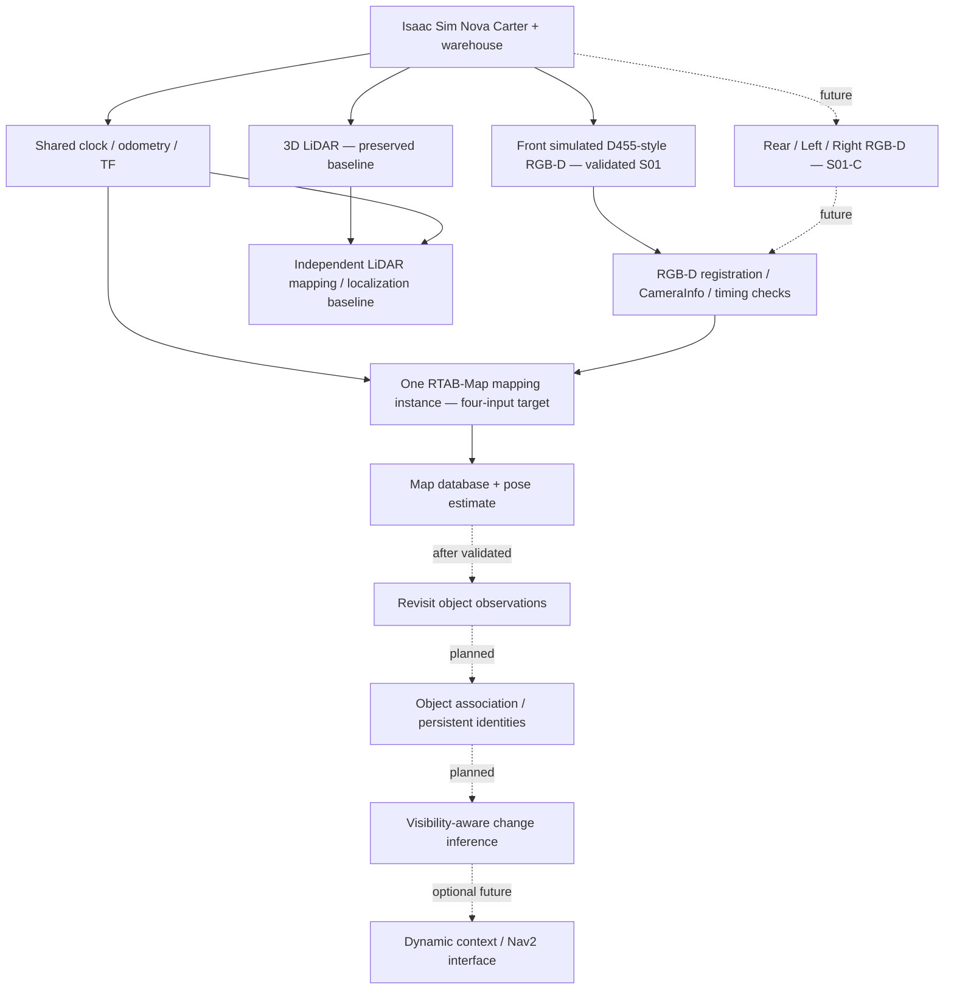

# ECHO — Architecture and Sensor Interface Reference

**Status:** architecture reference with verified historical elements and explicitly proposed interfaces.  
**Date:** 2026-11-20. **Not** a claim that the four-camera pipeline is already running.

## 1. System boundary

ECHO runs on Ubuntu 24.04 with NVIDIA Isaac Sim 6.2 and an NVIDIA RTX 5080. ROS 2 Jazzy, Nav2 and RViz2 support the existing white Nova Carter in a warehouse. The original 3D LiDAR, odometry/TF and navigation reference remain intact. RTAB-Map has been used with the **front** simulated D455-style RGB-D camera in preliminary S02 runs (reported from the prior session), but four-camera ingestion has **not** been demonstrated.

**Important:** The front S01 stage's CameraInfo/intrinsics are synthetic, not a hardware-level Intel RealSense D455 calibration. Likewise, simulated idealized depth is not a physical stereo-depth performance guarantee.

## 2. Verified and proposed components

| Component | Evidence/status | Relevant file or topic |
|---|---|---|
| Isaac warehouse + white Nova Carter | Existing baseline | `scenes/full_warehouse/main_robot_ros.usd` |
| Navigation reference | Previously verified | `scenes/echo_warehouse_nav_reference.usda`; `scripts/start_echo_sim.sh`; `scripts/start_echo_nav.sh` |
| 3D LiDAR | Previously verified and retained | `/front_3d_lidar/lidar_points` |
| Wheel/robot odometry | Previously observed | `/chassis/odom` |
| Front D455 RGB | S01 validated | `/echo/cameras/front/color/image_raw` |
| Front D455 depth | S01 validated | `/echo/cameras/front/depth/image_raw` |
| Front RGB/depth CameraInfo | S01 validated | `/echo/cameras/front/color/camera_info`; `/echo/cameras/front/depth/camera_info` |
| Front depth point cloud | S01 RViz observation | `/echo/cameras/front/depth/points` |
| Front registered depth | An isolated test published data; pixel alignment accuracy unverified in S01 report | `/echo/cameras/front/depth_registered/image_rect` |
| Rear, left, right RGB-D | **Proposed, not validated** | Namespaces to be assigned after source graph inspection |
| Four-input sync/fusion | **Proposed** | A supported `rtabmap_ros` input pipeline, actual version to inspect |
| Object memory / change inference | Early office prototypes in `results/experiment_01`–`05`, mobile implementation pending | Future ECHO nodes and data contracts |

## 3. Logical data flow



The arrows are a **target logical design**. Specifically, the rear/left/right inputs, four-input RTAB-Map map, mobile persistent-memory nodes and optional Nav2 memory interface are **not existing proven ROS graph links**.

## 4. Front camera technical checkpoint (from dated S01 report)

**Scene:** `scenes/s01_d455/s01_d455_front_ros_depth_raw_verified.usda`, a layered USD derived from the original scene; stage units `metersPerUnit = 1.0`, `upAxis = Z`. The original front Hawk was disabled in that derivative. Nine earlier S01 USD layers form dependencies; the D455 model comes from an external NVIDIA Isaac Sim 6.2 asset URL rather than a vendored USD.

| Property | Previously verified/reported |
|---|---|
| RGB | `640×480`, `rgb8`, ROS Image |
| Raw depth | `640×480`, `32FC1`, metres |
| Intrinsics | `fx = fy = 317.0431199837856 px`, `cx = 320`, `cy = 240` |
| Distortion model | `plumb_bob`, zero five-coefficient vector |
| Parent frame | `RSD455` |
| RGB optical static TF translation | `(0, 0.0115, 0)` m relative to `RSD455` |
| Depth optical static TF translation | `(0, 0, 0)` m relative to `RSD455` |
| Optical TF quaternion (XYZW) | `(0.5, 0.5, -0.5, -0.5)` for both optical frames |
| RGB/depth offset | 11.50 mm measured in prior TF check |
| 10 s subscriber observation | 396 RGB, 379 depth, ~28.97/27.66 Hz in sim time, exact matches 366/379 (96.6%) |
| One depth sample | valid fraction 1.0, min 0.4565 m, median 9.2555 m, max 9.5504 m |

**Known limitations:** timestamp offsets up to 33.33 ms were observed. `depth_image_proc` point cloud initially failed due to mismatched CameraInfo QoS; changing depth CameraInfo relay publication to RELIABLE enabled point cloud visualization. Registration produced a depth image in the color optical frame but full quantitative reprojection was not proven. The exact TF owner/ROS Action Graph paths must be read from code/USD before replication, rather than inferred from these summary values.

**Front software:** `scripts/start_echo_d455_front_stack.sh`, `scripts/echo_d455_front_static_tf.py`, `scripts/echo_d455_front_depth_camera_info.py`, `scripts/start_echo_d455_front_helpers.sh`, `config/rviz/echo_d455_front.rviz`. In the successful observed launch, an existing Isaac Sim instance was reused; the operator manually opened the verified USD and pressed Play. Full cold-start and lifecycle were not validated in S01.

## 5. Future camera contract (S01-C)

For each of `front`, `rear`, `left`, `right`, the stable consumer-side interface should contain:

- `sensor_msgs/msg/Image` RGB with explicit encoding, size, optical frame and `/clock`-based header stamp.
- `sensor_msgs/msg/Image` depth with explicit `32FC1` metres or `16UC1` millimetres, invalid-value policy, registered-to-RGB semantics or documented non-colocated RGB/depth geometry.
- `sensor_msgs/msg/CameraInfo` with matching projection, resolution and frame.
- A uniquely named rigid mount, camera link and correctly oriented ROS optical frames; **one TF publisher per frame relationship**, and no duplicate parents.
- A recorded camera-to-base transform in metres/quaternion, derived from the actual USD hierarchy, rather than copied blindly from the front or the legacy Hawk positions.
- Measured ROS QoS, RGB/depth pairing, inter-camera temporal skew, individual Hz and simulator overhead.

**Naming convention (proposed, not necessarily literal topics):**

```text
/echo/cameras/<direction>/color/image_raw
/echo/cameras/<direction>/color/camera_info
/echo/cameras/<direction>/depth/image_raw
/echo/cameras/<direction>/depth/camera_info
/echo/cameras/<direction>/depth_registered/image_rect
```

Only the **front** subset has been observed and documented. Do not create rear/left/right nodes simply because their path strings appear here.

### Mount reference positions (historical Hawk cameras, *not* final D455 extrinsics)

| Direction | X (m) | Y (m) | Z (m) |
|---|---:|---:|---:|
| Front | 0.0993 | 0 | 0.3334 |
| Rear | -0.5627 | 0 | 0.3334 |
| Left | -0.3554 | 0.1490 | 0.3334 |
| Right | -0.3554 | -0.1490 | 0.3334 |

Inspect yaw/pitch, parent prim, chassis occlusion, mounting clearance and all layer units before using any candidate placement.

## 6. Mapping and relocalization boundaries

**S02 prior work:** Front D455 RGB-D and 3D LiDAR were recorded over a short shared trajectory, and RGB-D RTAB-Map produced a preliminary map. Some launch/analysis scripts are untracked as of 20 Nov. See `docs/echo_s02_preliminary_comparison.md` for provisional measurements and their limits.

**S01-D target:** A *single* RTAB-Map process with synchronized observations from four calibrated RGB-D cameras and shared odometry. Confirm the installed `rtabmap_ros` version and actual supported `rgbd_sync`, `rgbd_images` or equivalent interface from local package descriptions before writing launch files. Do not equate four per-camera RTAB-Map nodes with a unified map. Validate transform frames, timestamp policy, `CameraInfo`, image registration and per-view contribution.

**Localization experiments come later.** A successful mapping database or matching odometry path does not prove recovery of an unknown global pose. Keep independent GT separate from localization inputs.

**LiDAR baseline:** The 3D LiDAR may require a different mapping/localization backend, map representation or feature extraction than RGB-D RTAB-Map. Document that confounder when comparing configurations.

## 7. Persistent object information model (proposed)

A candidate per-object memory record can hold:

```yaml
object_id: ECHO_0001           # persistent internal ID, not simulator object path
class_label: box              # confidence and provenance required
pose_in_map: null             # estimated 3D pose + uncertainty
geometry: null                # extent or compact object model
appearance_descriptor: null   # optional for cross-view association
last_positive_observation: null
last_visibility_check: null
observation_count: 0
state: UNRESOLVED             # UNCHANGED / MOVED / APPEARED / REMOVED / OCCLUDED / UNRESOLVED
confidence: null
history: []                   # timestamped evidence records
```

This is a **data contract proposal**, not an existing file or implementation. Crucially, `REMOVED` requires adequate visibility and negative evidence; an absent detection in one image cannot establish removal. Store which camera(s), pose, pixels/rays and estimated uncertainty supported each observation. Keep simulator GT in a separate validation channel.

## 8. Runbook and ownership checkpoints

**Verified historical navigation startup:**

```bash
cd ~/echo
bash scripts/start_echo_sim.sh
# separate terminal, after sim starts
bash scripts/start_echo_nav.sh
```

**S01 front experiment (per S01 report):**

```bash
cd ~/echo
bash scripts/start_echo_d455_front_stack.sh
# In Isaac Sim, open verified S01 USD scene and press Play.
```

Before changes: inspect these scripts; snapshot Git status; never edit committed baselines or discard uncommitted files. Runtime diagnostics should record `ros2 topic list`, `ros2 topic info -v`, actual Image/CameraInfo header encodings, `tf2_echo`, `ros2 topic hz`, clock behavior and sim performance. Check ground truth only for evaluation.

## 9. Sim-to-real translation boundary

Reuse the **calibrated RGB-D data contract and algorithms**, not the exact simulator camera K matrix/TF/extrinsics as physical calibration. Four actual D455 units will require camera-to-base extrinsic calibration, hardware timestamping, USB 3 bandwidth/power topology, depth invalidity/noise, lighting/reflections, overlap/IR projector interference, mounting constraints and compute load assessment. D455 and 3D LiDAR cannot be ranked for physical hospital deployment based on idealized Isaac Sim point clouds alone.
