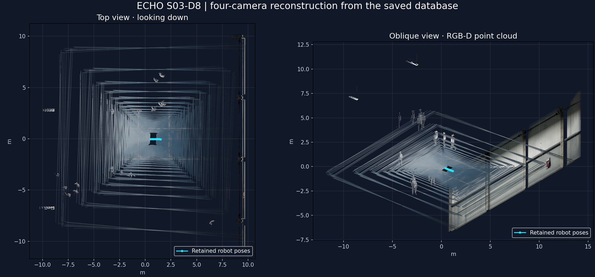
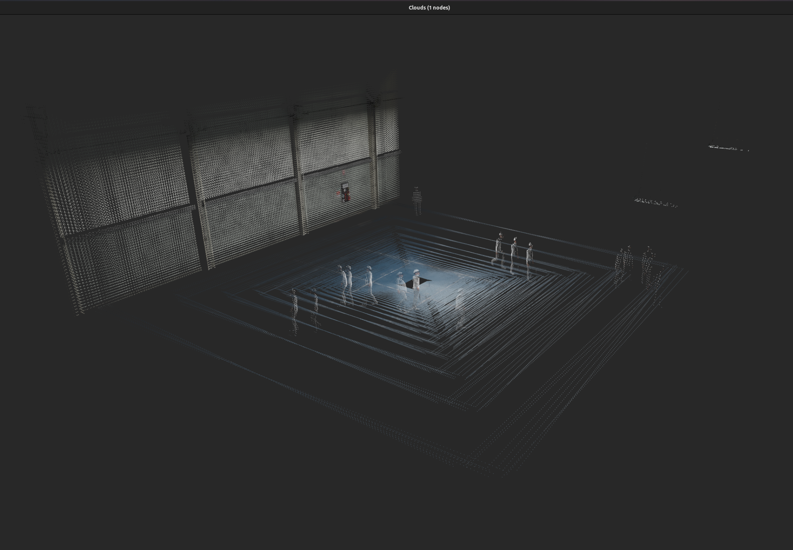

# ECHO — Phase C closeout: S01–S03 four-D455 integration and mapping

**Date:** 27 November 2026
**Branch:** `echo/s01-d455`
**Prior verified checkpoint:** `67ebaec` (reversible coupled XY camera calibration).
**Disposition:** Engineering baseline ready for closure; controlled mapping-quality evaluation deferred to S04. This is not a claim that every research question in the original roadmap has been resolved.

## 1. Objective and delivered baseline

ECHO (Environmental Change and History of Objects) studies persistent object-aware world modeling, multi-view relocalization and revisit-aware environmental change reasoning. Phase C establishes a working four-view RGB-D observation and geometric mapping pipeline, retaining the existing 3D LiDAR and navigation reference. Environment: Ubuntu 24.04, Isaac Sim 6.2, ROS 2 Jazzy, RTX 5080, Nova Carter, RTAB-Map database format 0.23.14.

- White Carter: front, rear, left and right D455-style RGB-D cameras, mounted in the derived scene `scenes/s01_d455/s01_d455_four_rgbd_raw_trial.usda`.
- Four separate RGB/depth/CameraInfo/TF pipelines, registered RGB-D and a single `/echo/s03/rgbd_images` aggregate (`rtabmap_msgs/msg/RGBDImages`, BEST_EFFORT).
- Dynamic warehouse: two moving red NPC Carters and two animated workers. Main robot is driven by NAV-0; original LiDAR and navigation baselines preserved.
- One-command supervisor `scripts/start_echo_dynamic_four_d455.py`; synchronization `launch/echo_s03_four_rgbd_sync_probe.launch.py`; odometry `/chassis/odom`, `odom -> base_link`.
- NAV-0: `launch/echo_nav0.launch.py`, odom-frame rolling costmaps, DWB + NavFn, LiDAR-derived `/scan`, velocity smoother and collision monitor. RTAB-Map is a separate mapping consumer, not the navigation pose source in D8.

Earlier integration checkpoints: `dcdfa10` four-camera integration, `f28d052` dynamic warehouse, `7f789dd` supervisor, `e7f83b4` bounded motion probe, `16d1396` D3 calibration, `541f4c1` experimental depth-only correction, `d26a6ca` NAV-0, `c42a081` cleanup, `ea00c4d` D5M ground-truth report, `67ebaec` coupled XY integration. These IDs are historical checkpoints from the project record; this report does not change their code.

## 2. Geometry, timing and calibration (D3–D6)

Nominal depth camera translations in `base_link`, metres: front `(0.120, 0, 0.344)`, rear `(-0.584, 0, 0.344)`, left `(-0.232, 0.171, 0.344)`, right `(-0.232, -0.171, 0.344)` (rounded). The optical TF, USD camera transforms, RGB/depth CameraInfo and native cloud streams were checked in earlier experiments. Four-camera image resolution 640 x 480, focal lengths 317.04311998 px.

Baseline principal point `(320,240)` remains the default. Opt-in `--calibration coupled_xy` adjusts both RGB and depth K/P principal points to `(319.5,239.5)`, retaining focal lengths, TF and raw image payloads. The depth-only correction was not selected because it can introduce registration holes. D3 offline vertical adjustment improved inter-camera floor slope agreement approximately 814x; independent D4F chassis pose supports the common residual slope being robot pitch (median pitch about -0.09055 degrees). A sampled authored warehouse floor is horizontal. The ~33.33 ms difference between timeline and SimulationManager time remains a timing caveat.

D5N-A actual ROS `depth_image_proc` replay of archived frames and independent floor/sphere reference geometry:

| Camera | Baseline floor RMSE (mm) | Coupled XY floor RMSE (mm) |
|---|---:|---:|
| Front | 2.334592 | 0.000092 |
| Rear | 2.797911 | 0.000147 |
| Left | 2.937657 | 0.922786 |
| Right | 2.667092 | 0.000100 |

Left-camera primary result includes all reference pixels, including 94 localized outliers above 1 mm; cause unverified. Front sphere radial RMSE on common reference samples: native 2.295572 -> 1.676532 mm; RGB-registered 2.187444 -> 1.691445 mm. These are selected ideal-simulation references, not physical D455 accuracy or complete scene error bounds.

D5N-B live parallel replay: 277 paired camera observations, 84,813,244 valid matched depth samples; reported identical depth values/masks and RGB payloads. Both aggregate streams showed at most 50 ms stamp spread during the sampled interval. D5N-C selected-mode audit verified corrected ROS native cloud subscriptions and numeric principal points for all four cameras; 170/170 aggregate samples at about 9.43 Hz, max 50 ms skew. Rollback audit: 185/185 at about 9.41 Hz, max 33.33 ms skew, native cloud principal point restored to baseline. These rates are sampled diagnostics, not controlled throughput comparisons. Earlier static synchronization measured about 11 Hz and max 33.33 ms on ten samples; dynamic throughput is lower and variable.

D6 single-pose overlap test (four native depth frames, sampled every fourth pixel, 0.25–8 m): zero sampled points projected inside another camera's image FOV. This is consistent with the roughly orthogonal outward-facing axes, separated mounts and limited horizontal FOV. It establishes absence of useful simultaneous overlap in the sampled configuration, not global lack of overlap or cross-camera error. Quantitative adjacent-view agreement via temporally revisited static surfaces remains open and transfers to S04. No new overlap score is inferred from D8 visualization.

Prior detailed reports include `docs/ECHO_S03_D5M_RGB_DEPTH_GROUND_TRUTH_20261124.md` and `docs/ECHO_S03_D5N_ROS_CALIBRATION_VALIDATION_20261127.md`.

## 3. D7 — chassis-to-ROS odometry consistency

Trial 2 used coupled XY and NAV-0, with a terminal-controlled in-process Isaac physics pose logger and a passive ROS logger. The original failed trial (ROS logger reserved `Node.handle` collision) is not evidence for the successful run. The corrected tools were exercised in the live trial; temporary launcher copies were prepared outside the repository. The `tools/s03_d7/` files preserve the tested launcher preparation and loggers; `analyze_d7.py` reproduces the trajectory comparison. Preparation uses audited launcher hashes and intentionally refuses to overwrite an existing trial2 directory. The old Phase A actor logger has not been converted to one-command operation by this work.

Protocol: stationary interval, supervised 0.30 m NAV-0 goal, post-goal interval. NAV-0 returned SUCCEEDED. Requested goal is not actual travel: commanded interval yielded about 0.201 m physical displacement, consistent with the 0.10 m goal tolerance. Slow physical creep of about 11 mm per 10 simulation seconds was seen before and after the goal; cause unverified. No wheel-odometry error experiment was performed.

Reanalysis of the original JSONL files: linearly interpolate world chassis XY and unwrapped yaw onto ROS odometry timestamps using SimulationManager time, no extrapolation; align initial planar position and yaw only (no full-trajectory fitting).

| Measurement | Result |
|---|---:|
| Physics pose records | 3,221 |
| ROS odometry records | 2,453 |
| Matched ROS samples | 2,298 |
| Common time interval | 32.016666666–70.333333333 sim s |
| Physics sampling errors | 0 |
| Planar RMSE | 0.376789 mm |
| Maximum planar discrepancy | 2.022273 mm |
| Heading RMSE | 0.005020 deg |

Captured OmniGraph connects `chassis_link` to `IsaacComputeOdometry` and `ROS2PublishOdometry` (`chassis/odom`). The physics readout is obtained separately but both signals describe the same simulated chassis; this is a simulator-to-ROS consistency result, **not independent wheel odometry or SLAM localization accuracy**. Time association uses numerical timestamps; camera exposure timing is not independently established.

## 4. D8 — concurrent navigation and four-camera RTAB-Map pilot

Same running corrected four-camera scene and NAV-0; one RTAB-Map instance `/echo_s03_d8/rtabmap`, input `/echo/s03/rgbd_images` and `/chassis/odom`, `use_sim_time=true`, `frame_id=base_link`, `rgbd_cameras=0`, `subscribe_rgbd=true`, RGB/depth standalone subscriptions disabled, scan/scan-cloud subscriptions disabled, `publish_tf=false`, QoS 2, `Grid/RangeMax=10.0`, detection rate 1 Hz simulation time, incremental memory enabled. The exact recorded parameter dump is `ECHO_S03_D8_RECORDED_PARAMS_20261127.yaml` (historical evidence, contains original absolute DB path, not a reusable launch file).

Three supervised 0.40 m forward goals: all succeeded; user visually confirmed movement in all three. Net odometry displacement from first goal start to final sampled pose about 0.94 m. Requested total 1.20 m; small goal tolerance and creep affect the measured result. This was not a full warehouse traversal or closed-loop revisit.

| Saved database / graph measurement | Result |
|---|---:|
| SQLite integrity check | ok |
| Stored observations (Node/Data) | 113 |
| Retained graph poses (weight >= 0) | 9 |
| Intermediate/rehearsed rows (weight -9) | 104 |
| Retained node IDs | 1, 51, 52, 53, 63, 64, 71, 72, 74 |
| Stored camera models | 452 (four per observation) |
| Stored calibration | fx=fy=317.04311998, cx=319.5, cy=239.5, 640 x 480 |
| Stored nonempty LiDAR scan rows | 0 |
| Retained graph path length (native viewer) | 0.986124 m |
| Neighbor links (native viewer) | 8 |
| Graph loop closures (native viewer) | 0 |
| Database disk usage (operator terminal) | 281 MiB rounded |

The database also contains type-1 links involving rehearsed/intermediate records; do not count them as independently validated loop closures. The final live map-to-odom was identity, and no global relocalization was attempted.

Offline reconstruction: read-only SQLite, RTAB-Map 0.23.14 camera serialization, RGB and 32-bit float depth mosaic, stride 4, valid depth >0 and <=10 m, optical-to-base camera transforms and retained odometry poses. Result 433,925 colored samples (front 172,476; rear 83,128; left 91,466; right 86,855), before voxel deduplication. Reproduced by `tools/s03_d8/reconstruct_d8.py`. It is not the native optimized cloud or a count of unique surfaces.



Native RTAB-Map Database Viewer opened a copy of the original database. Graph View confirmed nine poses and a 0.986124 m path. Dense RGB-D cloud assembled with requested decimation 4, 10 m max depth, 0.02 m voxel size, no meshing or smoothing. Native cloud window shows one assembled output; it does not independently establish the number of source poses. Screenshot shows recognizable wall/floor structure and repeated human-shaped returns consistent with moving-agent ghosting; identities, counts and motion are not independently labeled by RTAB-Map. The visual check does not quantify map accuracy, temporal seam alignment or contamination.



## 5. Reproduction runbook

Use separate terminals, source the ROS environment in each:

```bash
cd ~/echo
source /opt/ros/jazzy/setup.bash
source "$HOME/IsaacSim-ros_workspaces/jazzy_ws/install/local_setup.bash"
export ROS_DOMAIN_ID=0
export RMW_IMPLEMENTATION=rmw_fastrtps_cpp
export ECHO_S03_DEPTH_CY_MODE=baseline
```

Simulator: `python3 scripts/start_echo_dynamic_four_d455.py --calibration coupled_xy --check` then `python3 scripts/start_echo_dynamic_four_d455.py --calibration coupled_xy`; after startup press Play. Do not start duplicate camera helpers. NAV-0 in a separate terminal: `ros2 launch ~/echo/launch/echo_nav0.launch.py`; wait for managed nodes active. Normal launch is unchanged; for D7 logging use the archived terminal-control preparation only after reading its guards and preserving the previous trial directory. It creates temporary copies, not a committed launcher modification.

D8 mapping (new database directory, separate terminal):

```bash
D="$HOME/Downloads/echo_s03_mapping_$(date -u +%Y%m%dT%H%M%SZ)"
mkdir "$D" && ros2 run rtabmap_slam rtabmap \
  --Grid/RangeMax 10.0 --ros-args \
  -r __node:=rtabmap -r __ns:=/echo_s03_d8 \
  -r rgbd_images:=/echo/s03/rgbd_images -r odom:=/chassis/odom \
  -p use_sim_time:=true -p frame_id:=base_link \
  -p subscribe_rgbd:=true -p rgbd_cameras:=0 \
  -p subscribe_rgb:=false -p subscribe_depth:=false \
  -p subscribe_scan:=false -p subscribe_scan_cloud:=false \
  -p publish_tf:=false -p qos:=2 -p qos_odom:=2 \
  -p database_path:="$D/rtabmap.db" 2>&1 | tee "$D/rtabmap.log"
```

Check mapping info before motion. Use the existing guarded goal script `python3 scripts/echo_nav0_short_goal.py --distance 0.40 --execute --max-wall-seconds 60` only with a clear route and supervision. Stop if blocked or unsafe. Record `/clock`, `/chassis/odom`, `/cmd_vel`, `/echo_s03_d8/info` and `/echo_s03_d8/mapGraph`; dump effective params. Stop recorder then RTAB-Map gracefully with Ctrl+C; stop NAV-0 then supervisor. No forced kill or overwrite of prior data. Longer motion requires S04 safety validation first.

Offline tools (Python dependencies NumPy, SciPy for D7; OpenCV, NumPy, Matplotlib for D8):

```bash
python3 tools/s03_d7/analyze_d7.py ~/Downloads/echo_s03_d7_trial2
python3 tools/s03_d8/reconstruct_d8.py \
  ~/Downloads/echo_s03_d8_pilot_01/echo_d8_20261127T180557Z.db \
  --output ~/Downloads/echo_d8_reconstruction_review
```

The second command requires a new output directory. Review the saved DB in `rtabmap-databaseViewer` using a copy. Both offline tools were rerun against the uploaded originals; D7 RMSE and D8 sample counts reproduced. D8 reconstruction parser is intentionally version-specific.

## 6. Archive and closeout decision

Retain raw archives outside Git (local Downloads, then backed-up experiment storage). Do not commit DBs, bags or large PLYs. See checksums in `ECHO_PHASE_C_EVIDENCE_SHA256_20261127.txt`.

| Original remaining Phase C task | Disposition |
|---|---|
| Independent floor/chassis geometry reference | Completed at sampled ideal-simulation scope (D4F/D5M/D5N) |
| Baseline versus corrected calibration on identical input | Completed; opt-in coupled XY and baseline rollback verified |
| Adjacent-camera overlapping cloud alignment | Partially addressed: sampled simultaneous overlap absent; temporal alignment deferred to S04 |
| White Carter pose/odometry validation | Completed as simulator-to-ROS consistency; realistic independent odometry remains open |
| Controlled combined mapping pilot | Completed: three successful supervised goals, nine retained poses, four models per observation |
| Documentation and source checkpoint | This closeout package; pending operator Git review/commit/push |

**Recommendation:** close Phase C as the working engineering baseline, with the explicit deferred items above. This does not certify full mapping accuracy, independent localization, real D455 performance, universal Nav2 obstacle safety or a persistent semantic world model.

### Phase D / S04 handoff (no new Phase C milestones)

1. Validate NAV-0 obstacle stopping and stale-sensor response before longer routes. Keep the existing LiDAR navigation baseline intact.
2. Define controlled routes with turns and repeated static surfaces, ground truth, agent states and common odometry inputs. Quantify temporal multi-view alignment, coverage, geometry and throughput.
3. Compare one D455, four D455s and 3D LiDAR fairly, keeping navigation sensing separate from mapping input; compare stationary versus moving agents and measure ghosting. Do not treat D8 as this controlled comparison.
4. Carry calibration limits, physical creep and independent pose-estimation provenance into the experiment design. S05 global relocalization/revisits follow S04; object memory, visibility-aware change reasoning and dynamic tracking follow the original roadmap.

The repeated human-shaped returns in D8 motivate ECHO's future work: time-indexed instance observations, persistent identity and motion/visibility reasoning rather than treating every historical observation as a permanent obstacle. This is a proposed capability, not implemented in Phase C.
