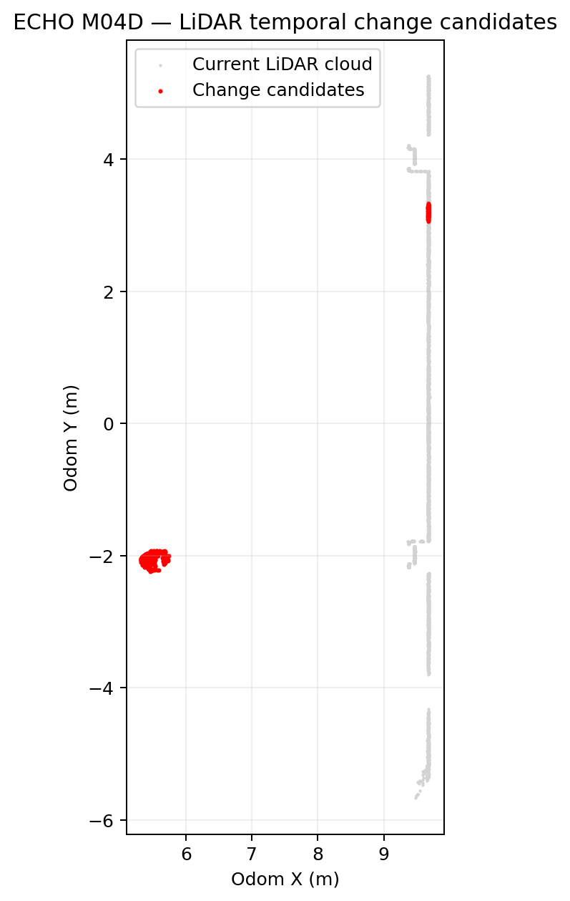

# ECHO — Phase B: Dynamic Warehouse (M04C–M04D)

## Objective

Establish a reproducible warehouse simulation with moving
agents, working ROS 2 sensors, and experimentally validated
dynamic-object observations.

## M04C — Dynamic Agents

- Two independently moving red IRA Nova Carters.
- Two independently moving animated warehouse workers.
- Four unique runtime agent identities verified.
- Ground-truth trajectories recorded at 10 Hz.
- 604 trajectory rows collected in the validated run.
- Baseline commit: e440a60.

## M04D — Sensor Validation

### Controlled experiment

- One warehouse worker following a repeatable crossing.
- White ROS Nova Carter with RGB camera and 3D LiDAR.
- Worker visibly observed in the camera.
- LiDAR returns observed near the worker.

### Recorded data

- ROS 2 Jazzy, MCAP, simulation timestamps.
- RGB images, camera calibration, 3D LiDAR, odometry,
  TF, and /clock.
- 25 seconds of overlapping ground truth.
- 251 worker ground-truth samples at 10 Hz.
- 27-second extracted sensor bag retained locally.

### Quantitative LiDAR validation

- 250 LiDAR frames evaluated.
- 250/250 frames contained at least 30 points near
  the ground-truth worker location.
- Median nearby point count: 331.
- Median cluster-center offset: 0.170 m.
- 95th percentile offset: 0.205 m.
- Robot displacement: 0.0245 m.
- Maximum robot yaw change: 0.951 degrees.

These measurements use ground-truth-gated point selection.
They are not autonomous detection accuracy.

### LiDAR-only temporal change preview

- Two scans separated by 5 seconds.
- Points transformed into the ROS odom frame using TF.
- Nearest-neighbor difference threshold: 0.25 m.
- 366 changed points identified.
- Dominant change region near (5.25, -2.25) m in odom.

### Limitations

- LiDAR-to-worker identity has not been established by
  an independent detector.
- World-to-odom calibration remains provisional.
- Temporal changes may include occlusion and static
  surfaces, not only moving humans.
- Autonomous clustering and tracking are future work.
- Moving red NPC sensor experiments remain future work.
- The RTX LiDAR MotionBVH warning needs consideration
  before quantitative dynamic-sensor evaluation.

## Reproduction

Start the isolated scenario:

    bash scripts/start_m04d_worker_crossing.sh

Press Play in Isaac Sim.

Run the LiDAR coverage analysis:

    PYTHONNOUSERSITE=1 python3 tools/m04d_lidar_gt_coverage.py

Run the LiDAR motion preview:

    PYTHONNOUSERSITE=1 MPLBACKEND=Agg python3 tools/m04d_lidar_motion_preview.py

These analyses require the local MCAP and ground-truth
files in diagnostics/m04d/.

## Conclusion

Phase B establishes a working dynamic warehouse,
verified sensor publication, reproducible human crossing,
timestamp-aligned experimental data, and an initial
LiDAR-only temporal change baseline.

Full autonomous detection, tracking, and persistent
object memory are outside the scope of M04D.

## Next Phase

M05 — Environmental Changes:
relocated objects, appearing/disappearing objects,
occlusions, and repeatable change-event ground truth.
